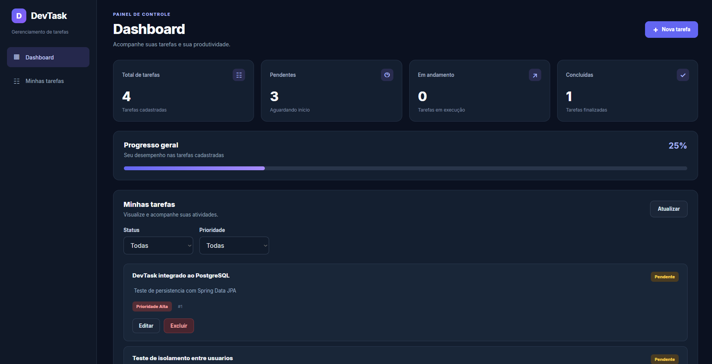
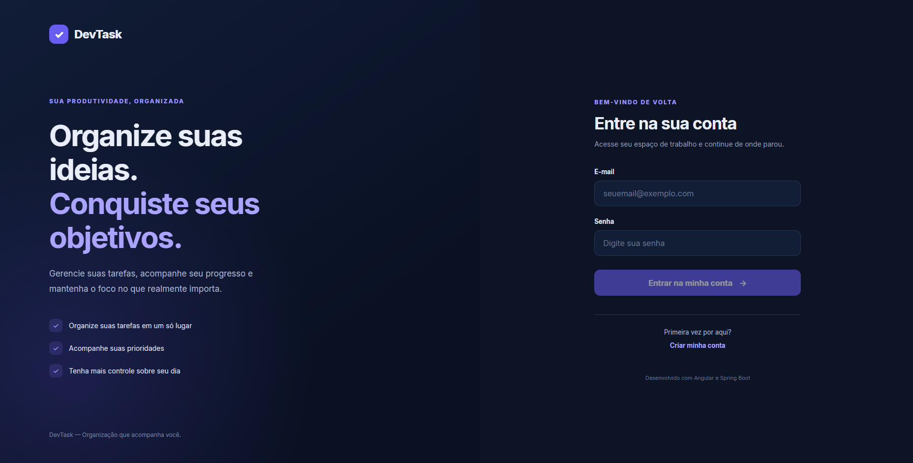
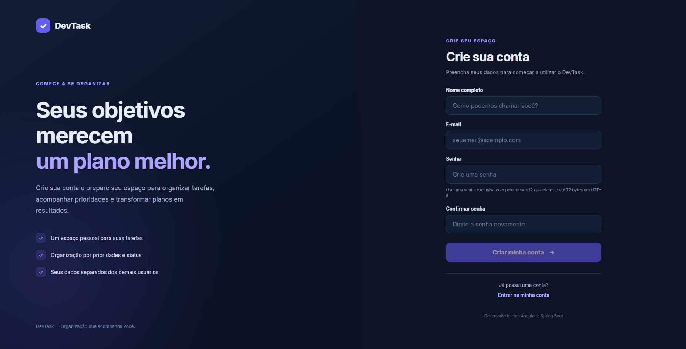

# DevTask

**Sistema web full stack para gerenciamento de tarefas, desenvolvido com Angular, Spring Boot e PostgreSQL.**

O DevTask é um projeto pessoal desenvolvido para colocar em prática conhecimentos de desenvolvimento web, APIs REST, banco de dados relacional, autenticação, segurança e testes de software.

A aplicação permite criar uma conta, organizar tarefas, definir prioridades, acompanhar o andamento das atividades e visualizar o progresso em um dashboard.

O sistema está publicado na internet, com frontend no Netlify, backend na Railway e PostgreSQL hospedado na nuvem.

## Acesse o projeto

**[Experimentar o DevTask](https://devtask-00qo.netlify.app/login)**

[Repositório no GitHub](https://github.com/fernandoaugustobueno10-wq/devtask)

Para testar a aplicação, crie uma conta e comece a organizar suas tarefas.

> O DevTask é um projeto de portfólio. Recomenda-se utilizar dados de demonstração, sem informações pessoais ou confidenciais.

## Demonstração

### Dashboard



### Login



### Cadastro



As capturas apresentam a interface do projeto durante o desenvolvimento.

## Tecnologias utilizadas

| Camada | Tecnologias |
|---|---|
| Frontend | Angular 22, TypeScript 6, HTML5, CSS3 e RxJS |
| Backend | Java 17, Spring Boot 4.1.2 e Maven |
| API | Spring Web MVC e Springdoc OpenAPI |
| Segurança | Spring Security, BCrypt, proteção CSRF e sessões HTTP |
| Persistência | Spring Data JPA e Hibernate |
| Banco de dados | PostgreSQL 18 |
| Migrações | Flyway |
| Testes | JUnit, Spring Boot Test e Spring Security Test |
| Hospedagem | Netlify e Railway |
| Versionamento | Git e GitHub |

## Funcionalidades

### Autenticação e usuários

- Cadastro de usuários com validação de dados.
- Autenticação por e-mail e senha.
- Login e logout.
- Gerenciamento de sessões.
- Proteção de rotas autenticadas.
- Separação das tarefas por usuário.

### Gerenciamento de tarefas

- Criar tarefas com título, descrição e prioridade.
- Consultar e listar tarefas.
- Editar informações das tarefas.
- Alterar o status das atividades.
- Excluir tarefas.
- Filtrar tarefas por status e prioridade.
- Consultar tarefas com paginação e ordenação.

As prioridades disponíveis são **baixa, média e alta**.

Os status disponíveis são **pendente, em andamento e concluída**.

### Dashboard

O dashboard apresenta informações sobre as atividades cadastradas, incluindo:

- Quantidade total de tarefas.
- Tarefas pendentes.
- Tarefas em andamento.
- Tarefas concluídas.
- Percentual geral de conclusão.
- Listagem e acompanhamento das atividades.

### Interface

- Tema escuro.
- Layout responsivo.
- Formulários com validação.
- Mensagens de erro e sucesso.
- Navegação por teclado.
- Gerenciamento de foco em modais.
- Melhorias de acessibilidade para leitores de tela.

## Arquitetura

O projeto está organizado em frontend, backend e banco de dados.

O frontend Angular é responsável pela interface e pelas interações com o usuário.

O backend Spring Boot fornece a API REST, implementa as regras de negócio, gerencia a autenticação e controla o acesso aos dados.

O PostgreSQL armazena os usuários e suas tarefas.

### Ambiente de produção

```text
                Usuário
                   |
                   | HTTPS
                   v
           Netlify - Angular
                   |
                   | /api/* via proxy HTTPS
                   v
          Railway - Spring Boot
                   |
                   | JDBC
                   v
          Railway - PostgreSQL
```

O frontend utiliza caminhos relativos `/api/...`. O Netlify encaminha essas requisições ao backend hospedado na Railway.

Essa estrutura permite manter as requisições da aplicação sob a mesma origem apresentada ao navegador.

### Ambiente de desenvolvimento

```text
             Navegador
                 |
                 v
       Angular - localhost:4200
                 |
                 | Proxy HTTP
                 v
      Spring Boot - localhost:8080
                 |
                 | Spring Data JPA
                 v
       PostgreSQL - localhost:5433
```

O ambiente local utiliza um proxy do Angular para encaminhar as chamadas da API ao backend.

## Estrutura do repositório

```text
devtask/
|
|-- .github/
|
|-- backend/
|   |-- database/
|   |   |-- 001_create_tarefas.sql
|   |   |-- 002_create_usuarios.sql
|   |   |-- 003_adicionar_proprietario_tarefa.sql
|   |   |-- 004_usuario_tarefa_obrigatorio.sql
|   |
|   |-- src/
|   |   |-- main/
|   |   |   |-- java/
|   |   |   |-- resources/
|   |   |       |-- db/
|   |   |           |-- migration/
|   |   |               |-- V1__criar_estrutura_inicial.sql
|   |   |
|   |   |-- test/
|   |
|   |-- pom.xml
|
|-- frontend/
|   |-- public/
|   |   |-- _redirects
|   |
|   |-- src/
|   |-- angular.json
|   |-- package.json
|   |-- proxy.conf.json
|
|-- docs/
|   |-- images/
|       |-- login.png
|       |-- cadastro.png
|       |-- dashboard.png
|
|-- .gitignore
|-- README.md
```

## Segurança

O DevTask utiliza diferentes mecanismos de proteção no backend e no frontend.

### Autenticação

- Autenticação gerenciada pelo Spring Security.
- Senhas armazenadas como hashes BCrypt.
- Sessões HTTP para usuários autenticados.
- Cookies de sessão com HttpOnly.
- Configuração SameSite=Lax.
- Cookies Secure ativados no ambiente de produção.

### Autorização

As operações de gerenciamento de tarefas verificam o usuário autenticado.

Cada usuário deve acessar somente suas próprias tarefas, impedindo que a simples alteração de um identificador permita consultar ou modificar registros de outras contas.

### Proteção CSRF

O projeto utiliza proteção CSRF nas operações sensíveis.

O frontend solicita um token ao backend e o envia nos cabeçalhos necessários para operações de escrita, incluindo cadastro, login, logout e alterações nas tarefas.

### Proteção contra tentativas de login

O backend implementa um mecanismo de limitação de tentativas de autenticação, incluindo:

- Controle por identificadores de origem e usuário.
- Bloqueio temporário.
- Resposta HTTP 429 quando aplicável.
- Cabeçalho Retry-After.
- Tratamento de tentativas concorrentes.
- Liberação de reservas pendentes em casos de falha.

O mecanismo mantém seus dados em memória. Para operação distribuída, com múltiplas instâncias do backend, será necessário adaptar essa implementação.

### Configuração de produção

- Credenciais do banco fornecidas por variáveis de ambiente.
- Comunicação pública por HTTPS.
- Cookie de sessão configurado como Secure.
- Swagger UI desativado na hospedagem.
- Validação do esquema de banco pelo Hibernate.
- Migrações SQL versionadas com Flyway.

### Auditoria de dependências

O projeto foi verificado com:

- `npm audit` para dependências do frontend.
- OWASP Dependency-Check para dependências Java.

Durante a revisão, foram identificados alertas relacionados ao Swagger UI. A dependência foi atualizada para a versão 5.35.1, e os alertas anteriores não reapareceram na verificação seguinte.

Essas ferramentas verificam vulnerabilidades conhecidas dentro das respectivas coberturas. Seus resultados não garantem a ausência de todas as vulnerabilidades.

O projeto não possui certificação formal de segurança nem auditoria independente.

## Banco de dados

O DevTask utiliza duas tabelas principais.

### usuario

Armazena os dados necessários ao cadastro e à autenticação.

Campos principais:

- id
- nome
- email
- senha_hash
- criado_em

O e-mail possui restrição de unicidade.

### tarefa

Armazena as atividades cadastradas pelos usuários.

Campos principais:

- id
- titulo
- descricao
- status
- prioridade
- data_criacao
- usuario_id

O campo `usuario_id` identifica o proprietário da tarefa e possui uma chave estrangeira para `usuario`.

O banco possui restrições de integridade e índices relacionados às consultas por usuário.

### Migrações

A pasta `backend/database` mantém os quatro scripts SQL históricos utilizados durante a evolução do projeto.

Para instalações novas, o Flyway utiliza a migração consolidada:

```text
backend/src/main/resources/db/migration/
V1__criar_estrutura_inicial.sql
```

Essa migração cria diretamente as tabelas, restrições e índices necessários à aplicação.

O procedimento foi testado em um banco PostgreSQL vazio, separado do banco local principal.

O Flyway permanece desativado por padrão para preservar instalações locais existentes.

Em um banco novo, pode ser ativado com:

```powershell
$env:FLYWAY_ENABLED = "true"
```

Não execute a migração inicial em um banco existente que já contenha as tabelas sem preparar antes uma estratégia de adoção e versionamento.

## Executando localmente

Os exemplos abaixo utilizam Windows e PowerShell.

### Requisitos

- Java 17.
- Maven.
- Node.js e npm compatíveis com Angular 22.
- PostgreSQL 18.
- Git.

Não é necessário utilizar Docker ou WSL.

### 1. Clonar o repositório

```powershell
git clone https://github.com/fernandoaugustobueno10-wq/devtask.git

cd devtask
```

### 2. Configurar o PostgreSQL

O ambiente local utilizado no desenvolvimento possui a seguinte configuração:

| Propriedade | Valor |
|---|---|
| Host | localhost |
| Porta | 5433 |
| Banco | devtask_db |
| Usuário | devtask_app |

É necessário criar o banco e o usuário, além de conceder permissões apropriadas.

Nenhuma senha de banco está incluída no repositório.

Para uma instalação nova, crie um banco vazio e utilize a migração Flyway V1.

Para uma instalação existente, mantenha o esquema compatível com as entidades Java.

### 3. Configurar a senha

No PowerShell em que o backend será executado:

```powershell
$senhaSegura = Read-Host "Senha do PostgreSQL DevTask" -AsSecureString

try {
    $env:DB_PASSWORD = [System.Net.NetworkCredential]::new(
        "",
        $senhaSegura
    ).Password
}
finally {
    $senhaSegura.Dispose()
    Remove-Variable senhaSegura -ErrorAction SilentlyContinue
}
```

A senha será armazenada na variável de ambiente do processo atual, sem precisar ser escrita no código.

### 4. Configurar o banco, se necessário

O backend aceita as seguintes variáveis:

| Variável | Função |
|---|---|
| DB_URL | Endereço JDBC do PostgreSQL |
| DB_USERNAME | Usuário do banco |
| DB_PASSWORD | Senha do banco |
| FLYWAY_ENABLED | Ativar migrações |
| PORT | Porta HTTP |
| SESSION_COOKIE_SECURE | Marcar cookie como Secure |
| API_DOCS_ENABLED | Habilitar OpenAPI |
| SWAGGER_UI_ENABLED | Habilitar Swagger UI |

Se `DB_URL`, `DB_USERNAME` e `PORT` não forem informadas, a configuração local utiliza os valores padrão definidos em `application.properties`.

Para ativar a migração em um banco novo e vazio:

```powershell
$env:FLYWAY_ENABLED = "true"
```

Para uma instalação local já existente, mantenha o Flyway desativado, conforme a configuração padrão.

### 5. Iniciar o backend

Na raiz do repositório:

```powershell
mvn -f backend/pom.xml spring-boot:run
```

O backend local utiliza:

http://localhost:8080

O Hibernate utiliza `ddl-auto=validate`, verificando a compatibilidade entre o esquema e as entidades Java.

### 6. Instalar as dependências do frontend

Em outro terminal, na raiz do repositório:

```powershell
cd frontend

npm install
```

### 7. Iniciar o Angular

Ainda na pasta `frontend`:

```powershell
npm start -- --proxy-config proxy.conf.json
```

Acesse:

http://localhost:4200

Com o PostgreSQL, o backend e o frontend funcionando, é possível cadastrar uma conta e utilizar o dashboard.

## Testes e validações

### Testes automatizados do backend

A aplicação possui **104 testes automatizados**, abrangendo:

- Regras de negócio.
- Validação de requisições.
- Operações com tarefas.
- Integração com o PostgreSQL.
- Autenticação e autorização.
- Controle de acesso entre usuários.
- Proteção CSRF.
- Controle de tentativas de login.
- Tratamento de falhas e exceções.

Na última validação local, os resultados foram:

```text
Tests run: 104, Failures: 0, Errors: 0, Skipped: 0
BUILD SUCCESS
```

Para executar:

```powershell
mvn -f backend/pom.xml clean test
```

Alguns testes exigem o PostgreSQL local disponível e a variável `DB_PASSWORD` configurada.

### Build do Angular

Para verificar a compilação:

```powershell
npm --prefix frontend run build
```

A compilação de produção foi validada durante o desenvolvimento e a preparação da hospedagem.

### Testes funcionais na aplicação publicada

Após a publicação no Netlify e na Railway, foram realizados oito testes funcionais:

| Funcionalidade | Resultado |
|---|---|
| Cadastro | Aprovado |
| Login | Aprovado |
| Criar tarefa | Aprovado |
| Editar tarefa | Aprovado |
| Consultar tarefas | Aprovado |
| Excluir tarefa | Aprovado |
| Logout | Aprovado |
| Persistência | Aprovado |

**Resultado: 8 de 8 fluxos testados com sucesso.**

Esses testes foram executados manualmente na aplicação publicada.

Também foram realizadas verificações durante o desenvolvimento relacionadas à responsividade, navegação por teclado e operações com modais.

## Documentação da API

O projeto utiliza Springdoc OpenAPI.

No desenvolvimento local, quando habilitada, a documentação Swagger pode ser acessada em:

http://localhost:8080/swagger-ui/index.html

Na configuração atual de produção, a documentação Swagger UI e a geração do endpoint OpenAPI estão desativadas.

## Hospedagem

A aplicação está organizada em três componentes:

**Frontend — Netlify**

Hospeda o build Angular, disponibiliza HTTPS e encaminha as requisições `/api/*` ao backend.

**Backend — Railway**

Executa a aplicação Spring Boot e utiliza variáveis de ambiente para suas configurações.

**Banco de dados — PostgreSQL na Railway**

Armazena os usuários e tarefas. O backend acessa o banco por meio da conexão configurada na plataforma.

A criação do esquema em um banco vazio foi validada com Flyway, e as funcionalidades principais foram testadas na aplicação publicada.

## Melhorias futuras

O DevTask continua sendo um projeto em evolução. Algumas melhorias planejadas são:

- Adicionar testes automatizados de ponta a ponta no frontend.
- Implementar monitoramento e alertas de disponibilidade.
- Revisar a arquitetura de sessões para múltiplas instâncias.
- Centralizar o controle de tentativas de login em armazenamento compartilhado.
- Automatizar verificações de segurança no pipeline de integração contínua.
- Ampliar os testes de acessibilidade.
- Melhorar as estratégias de backup e recuperação do banco.
- Adicionar novas funcionalidades de produtividade e organização.

## Sobre o projeto

Desenvolvi o DevTask como um projeto pessoal para aprofundar meus conhecimentos em desenvolvimento de software.

Durante o desenvolvimento, trabalhei com integração entre frontend e backend, modelagem e persistência de dados, autenticação, autorização, tratamento de erros, testes automatizados e segurança de aplicações web.

Uma das etapas mais importantes foi preparar o sistema para funcionar fora do ambiente local, incluindo a configuração do banco PostgreSQL na nuvem, a utilização de migrações Flyway e a publicação do frontend e do backend.

O projeto representa a aplicação prática de conhecimentos adquiridos durante a graduação e em estudos independentes.

## Autor

**Fernando Augusto Bueno Canquerini**

Estudante de Tecnologia em Análise e Desenvolvimento de Sistemas na Universidade Federal do Paraná (UFPR).

**GitHub:** https://github.com/fernandoaugustobueno10-wq

---

Projeto pessoal desenvolvido para aprendizado, prática profissional e portfólio.
